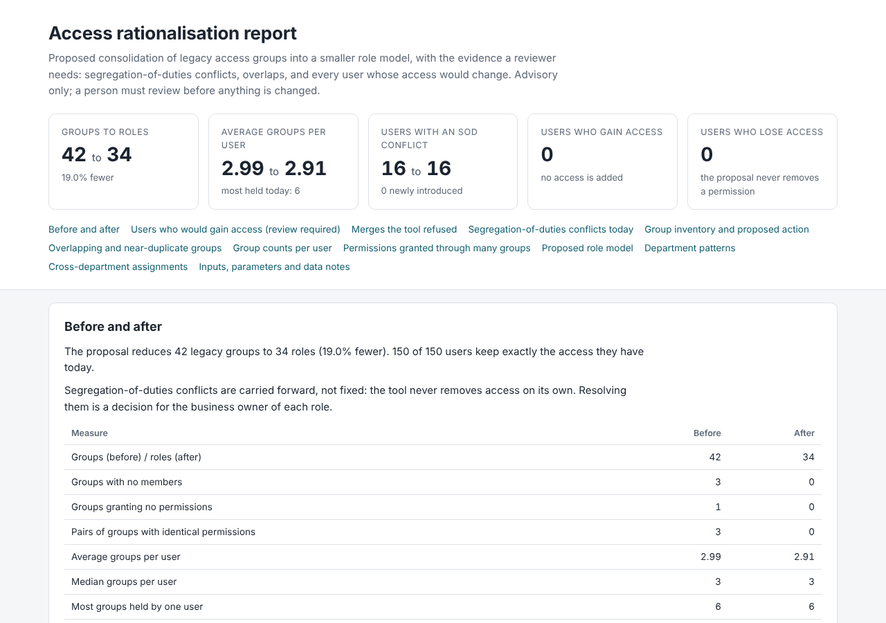
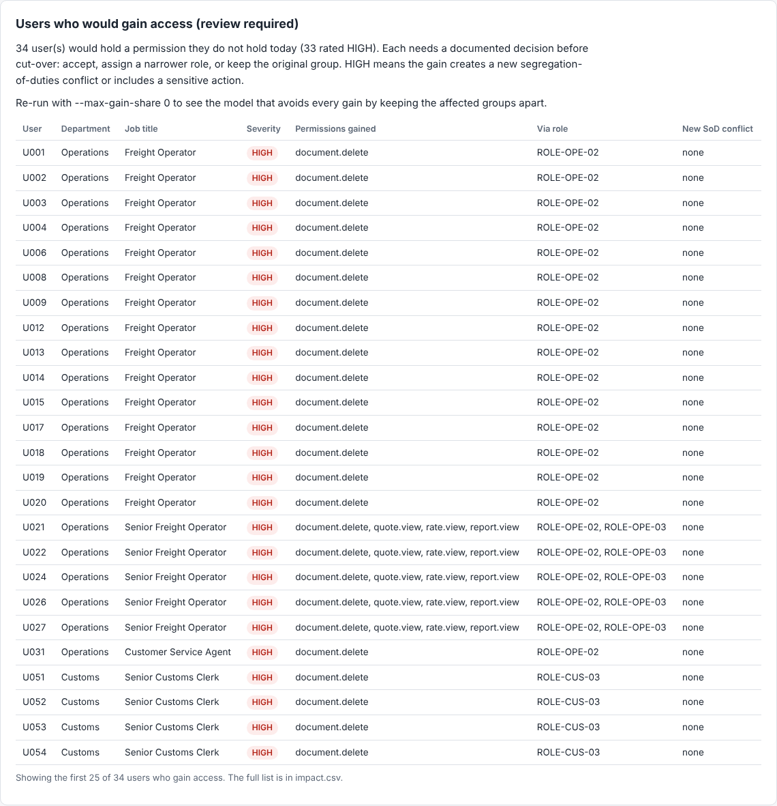

# access-rationalisation-toolkit

[](https://github.com/pJijesh/access-rationalisation-toolkit/actions/workflows/ci.yml) [](LICENSE)  

**Problem:** years of copied, overlapping and orphaned security groups leave business applications with more groups than roles, hidden segregation-of-duties conflicts, and no safe way to tidy up without breaking someone's job or quietly widening their access.

**For:** IT, security and risk leads who need to rationalise legacy access groups, and the reviewers and auditors who must sign the change off.

**Demonstrates:** a step-by-step method plus a small, dependency-free, deterministic Python tool that analyses a group estate, proposes a smaller role model, and refuses to give anyone extra access unless a human can see and approve it.



## Background

I led a project that rationalised more than 36 legacy ERP security groups across more than 150 staff. This repository turns that experience into a generic, reusable method and a worked tool. It contains no data, names or structures from that project or from any employer: the example is built from a seeded synthetic dataset with generic permission names, and every figure below comes from running the tool on that dataset.

## Before and after

Synthetic dataset, seed 42: 150 users, 42 legacy groups, 64 permissions, 448 memberships, 8 segregation-of-duties (SoD) rules.

| Measure | Before | After, safe default | After, `--max-gain-share 1` |
| --- | ---: | ---: | ---: |
| Groups (before) / roles (after) | 42 | 34 | 30 |
| Groups removed | n/a | 8 (19.0%) | 12 (28.6%) |
| Groups with no members | 3 | 0 | 0 |
| Groups granting no permissions | 1 | 0 | 0 |
| Pairs of groups with identical permissions | 3 | 0 | 0 |
| Average groups per user | 2.99 | 2.91 | 2.87 |
| Users holding more than 4 groups | 9 | 7 | 6 |
| Users with an SoD conflict | 16 | 16 | 16 |
| Users who gain access | n/a | 0 | 34 (33 rated HIGH) |
| Users who lose access | n/a | 0 | 0 |

The safe default consolidates only where nobody gains a permission. Removing the limit consolidates further and lists every affected user for review. SoD conflicts are reported and carried forward, never silently "fixed", because removing access is a business decision. Source: `examples/demo-output/summary.json` and `examples/demo-output-aggressive/summary.json`. The [worked example](docs/worked-example.md) walks through both runs, including the seven merges the tool refused and why.

## Quick start

Requires Python 3.10 or later. No third-party packages.

```bash
pip install -e .
access-rat generate-demo     # writes synthetic CSVs to ./demo-data
access-rat analyse           # writes reports and mappings to ./output
```

Open `output/report.html`. To see what more aggressive consolidation would cost:

```bash
access-rat analyse --max-gain-share 1 --out output-aggressive
```

## What it does

Given `users.csv`, `memberships.csv`, `group_permissions.csv` and an optional `sod_rules.csv`, it:

- measures group size, and overlap using Jaccard similarity of member sets and of permission sets
- finds empty groups, groups that grant nothing, near-duplicates, redundant memberships, users with excess groups, and permissions granted through many groups
- detects SoD conflicts per user, showing which groups grant each side, and flags groups that contain both sides themselves
- proposes a consolidated role model by merging groups whose permission sets are similar, within department patterns, and never into a role that newly combines the two sides of an SoD rule
- writes an old-to-new group mapping and a per-user impact list showing every permission each user would gain or lose, with severity, and flags anyone who would gain access

Outputs, all deterministic: `report.md`, `report.html`, `mapping.csv`, `impact.csv`, plus `roles.csv` and `summary.json` (with input hashes for audit evidence).



## Input format

| File | Required columns | Optional |
| --- | --- | --- |
| `users.csv` | `user`, `department`, `job_title` | |
| `memberships.csv` | `user`, `group` | |
| `group_permissions.csv` | `group`, `permission` | |
| `sod_rules.csv` | `permission_a`, `permission_b` | `rule_id`, `description` |

Bad input stops the run with every problem listed, including line numbers, and exit status 2.

## Key options

| Option | Default | Meaning |
| --- | --- | --- |
| `--threshold` | 0.8 | Permission-set Jaccard needed before groups can merge |
| `--max-gain-share` | 0 | Largest share of a role's members who may gain access through a merge. 0 forbids any gain |
| `--max-groups` | 4 | Users holding more groups than this are reported |
| `--fail-on-gain` | off | Exit with status 3 if anyone would gain access, for use in pipelines |
| `--data`, `--out` | `demo-data`, `output` | Input and output folders |

Run `access-rat analyse --help` for the full list.

## Documentation

- [Method](docs/method.md): discover, analyse, design roles, map, pilot, cut over, roll back, evidence for audit, stakeholder and communication plan, and approvals
- [Worked example](docs/worked-example.md): the commands and outputs behind the table above
- [Limitations](docs/limitations.md): what the tool does not decide, what it cannot see, and security caveats

## Tests

```bash
pip install -e ".[dev]"
python -m pytest -q
```

The suite covers similarity maths, SoD detection, the no-silent-privilege-gain rule, byte-for-byte determinism for the same seed and independence from input row order, CSV validation errors, and a check that the committed examples match a fresh run.

## Limitations and scope

This is an analysis aid, not an access-management system. It reads CSV files, makes no network calls and changes nothing. It has been run on synthetic data only, and the results in this repository describe that data, not any real organisation. Human review is required at every decision point; see [limitations](docs/limitations.md).

## Roadmap

Planned, not promised. Order and timing change with other work.

- **Next:** Accessibility check of the HTML report; Add import profiles for common CSV exports
- **Then:** Add guide to editing the conflict rule pack; Add access review campaign export
- **Later:** Test with 100,000 rows and document limits; Release v1.1

## Author

Puliyappottammal Jijesh. [GitHub](https://github.com/pJijesh) | [LinkedIn](https://www.linkedin.com/in/pjijesh)

## Licence

MIT. See [LICENSE](LICENSE). Contributions are welcome; see [CONTRIBUTING](CONTRIBUTING.md).
