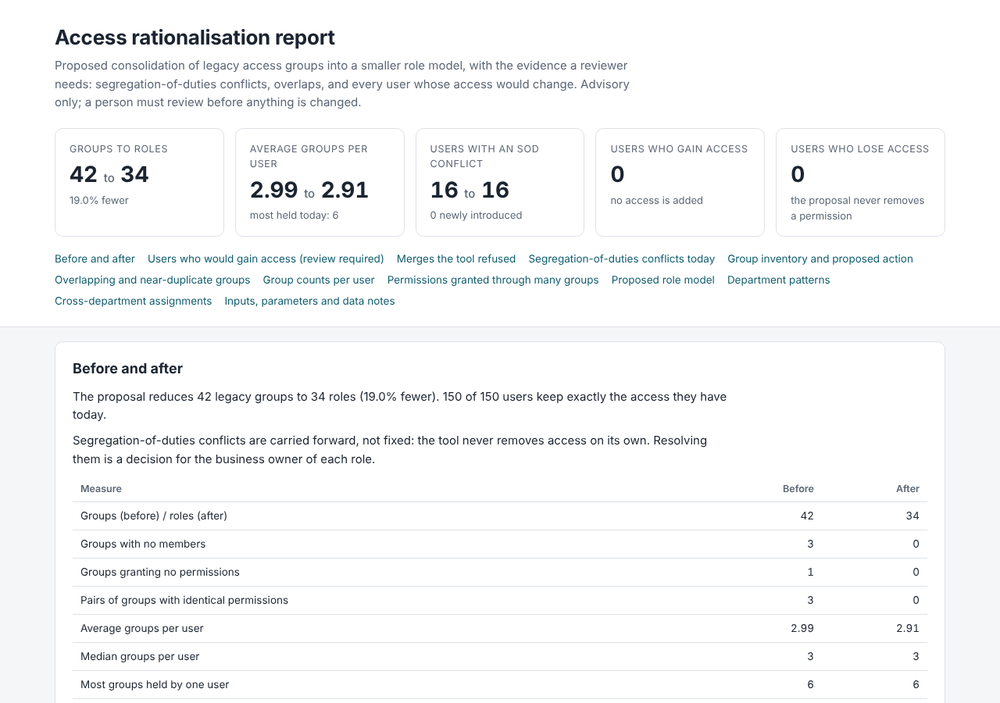
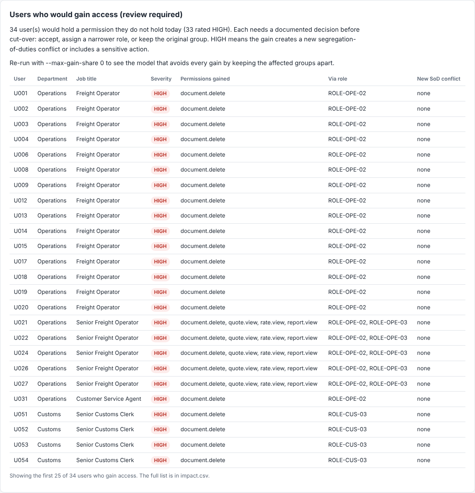

# Worked example on synthetic data

Everything on this page was produced by running the tool on the seeded demo dataset (`--seed 42`). The data is entirely synthetic: anonymous user ids, generic `module.action` permission names, and an invented freight-forwarding style structure. It was designed to be messy in the ways legacy estates usually are, so the numbers below describe this dataset only. They are not benchmarks and should not be read as a prediction for any real organisation.

The committed copies of the inputs and outputs are in [`examples/`](../examples/). A test regenerates them and fails if they differ, so this page cannot drift from the code without the build noticing.

## 1. Generate the data

```console
$ access-rat generate-demo
Wrote synthetic demo data (seed 42) to demo-data/
  group_permissions.csv
  memberships.csv
  sod_rules.csv
  users.csv
```

The dataset has 150 users in seven departments (operations, customs, finance, sales, warehouse, administration, management), 42 legacy groups, 64 permissions, 448 memberships and 8 segregation-of-duties rules. The deliberate mess is:

- 3 groups with identical permissions to another group (`OPS_BOOKING_COPY`, `CUS_DRAFT_TEMP`, `SAL_QUOTING`)
- "V2" and "OLD" variants that differ from their parent by one permission
- 3 orphan groups with permissions but no members, and 1 group with members but no permissions
- A few people carrying an extra basic group from another department
- Planted conflicts, such as accounts-payable clerks who can both create and approve payments, and one administrator group that holds both sides of a rule by itself

## 2. Analyse with the safe defaults

```console
$ access-rat analyse
access-rat 1.0.0
Loaded 150 users, 42 groups, 64 permissions, 448 memberships, 8 SoD rules
Groups -> roles: 42 -> 34 (19.0% fewer)
Retired groups: 4 (3 with no members, 1 granting no permissions)
Average groups per user: 2.99 -> 2.91
SoD: 16 users / 18 conflicts today; 16 users / 18 after (0 newly introduced)
Access changes: 0 users gain access (0 HIGH), 0 lose access, 150 unchanged
Merges refused by safety rules: 7
Wrote mapping.csv, impact.csv, roles.csv, report.md, report.html, summary.json to output/
```

### What the baseline analysis found

| Finding | Result |
| --- | --- |
| Groups with no members | 3 (`CUS_PROJECT_TEMP`, `FIN_YEAREND_OLD`, `OPS_TRIAL_OLD`) |
| Groups that grant no permissions | 1 (`SHARED_MAILBOX_LEGACY`, 5 members) |
| Pairs of groups with identical permissions | 3 |
| Pairs of groups with near-identical permissions (Jaccard 0.80 or more, not identical) | 11 |
| Redundant memberships (user keeps identical access without them) | 163 of 448; the most are `ALL_STAFF` (37) and `OPS_BASIC` (28) |
| Users holding more than 4 groups | 9; the most held by one user is 6 |
| Users with a segregation-of-duties conflict | 16 users, 18 conflict instances |
| Groups holding both sides of a rule by themselves | 1 (`SYS_ADMIN`, rule SOD-008) |

The 18 conflict instances split across the rules as: SOD-001 one, SOD-002 four, SOD-003 two, SOD-004 one, SOD-005 four, SOD-006 two, SOD-007 three, SOD-008 one.

### What the default design did

Four roles were formed by merging eight groups, all of them pairs where the permission sets are identical or where nobody gains anything:

| New role | Replaces |
| --- | --- |
| `ROLE-CUS-02` | `CUS_DRAFT`, `CUS_DRAFT_TEMP` |
| `ROLE-OPE-02` | `OPS_BOOKING`, `OPS_BOOKING_COPY` |
| `ROLE-SAL-02` | `SAL_QUOTE`, `SAL_QUOTING` |
| `ROLE-WAR-02` | `WH_OPERATIVE`, `WH_OPERATIVE_OLD` |

Together with the four retired groups, that takes 42 groups to 34 roles. The last row works only because the single `WH_OPERATIVE_OLD` member already held `WH_OPERATIVE`, so nobody gained anything.

Seven further merges met the 0.80 similarity threshold and were refused, because each would have handed new access to a large share of the merged role's members:

| Candidate merge | Similarity | Refused because |
| --- | --- | --- |
| `CUS_DRAFT`, `CUS_DRAFT_TEMP` with `CUS_SUBMIT` | 0.88 | 5 of 11 members (45%) would gain access |
| `CUS_SUBMIT` with `CUS_SUBMIT_V2` | 0.89 | 6 of 8 (75%) |
| `FIN_AR` with `FIN_AR_V2` | 0.83 | 6 of 9 (67%) |
| `OPS_BOOKING`, `OPS_BOOKING_COPY` with `OPS_BOOKING_V2` | 0.92 | 21 of 26 (81%) |
| `OPS_BOOKING`, `OPS_BOOKING_COPY` with `OPS_SENIOR` | 0.86 | 17 of 26 (65%) |
| `OPS_BOOKING_V2` with `OPS_SENIOR` | 0.80 | 8 of 11 (73%) |
| `OPS_SENIOR` with `OPS_SUPERVISOR` | 0.82 | 6 of 10 (60%) |

This is the point of the exercise. Every one of these pairs looks like an obvious merge on similarity alone. None is safe without a decision.

The segregation-of-duties conflicts are unchanged (16 users, 18 instances before and after, none newly introduced), because the tool carries existing access forward and leaves conflict resolution to a person.



## 3. Allow more consolidation and see who gains

Setting `--max-gain-share 1` removes the gain limit. The tool then merges every pair that passes the similarity and segregation-of-duties checks, and lists everyone who gains access:

```console
$ access-rat analyse --max-gain-share 1 --out output-aggressive
access-rat 1.0.0
Loaded 150 users, 42 groups, 64 permissions, 448 memberships, 8 SoD rules
Groups -> roles: 42 -> 30 (28.6% fewer)
Retired groups: 4 (3 with no members, 1 granting no permissions)
Average groups per user: 2.99 -> 2.87
SoD: 16 users / 18 conflicts today; 16 users / 18 after (0 newly introduced)
Access changes: 34 users gain access (33 HIGH), 0 lose access, 116 unchanged
Wrote mapping.csv, impact.csv, roles.csv, report.md, report.html, summary.json to output-aggressive/
```

That is 12 fewer groups instead of 8, at the price of 34 users who would hold a permission they do not hold today. The gained permissions are `document.delete` (27 users), `quote.view`, `rate.view`, `report.view` and `customer.set_credit_limit` (6 users each, some users gaining several). 33 of the 34 are rated HIGH because `document.delete` and `customer.set_credit_limit` match the sensitive-action list.

The root cause is visible in the mapping. `OPS_BOOKING_V2` is `OPS_BOOKING` plus `document.delete`. Merging them gives `document.delete` to every holder of `OPS_BOOKING`:

```text
old_group,old_members,old_permissions,action,new_role_id,...,permissions_added_to_group,members_gaining_via_role
OPS_BOOKING,22,12,merge (similar permissions),ROLE-OPE-02,...,1,21
OPS_BOOKING_V2,5,13,merge (similar permissions),ROLE-OPE-02,...,0,0
```

One user's row in `impact.csv` (`U021`, a Senior Freight Operator), shown as field and value:

```text
old_groups           ALL_STAFF; OPS_BASIC; OPS_BOOKING; OPS_SENIOR
new_roles            ROLE-MIX-01; ROLE-OPE-01; ROLE-OPE-02; ROLE-OPE-03
old_permission_count 14
new_permission_count 18
gains_access         YES
gained_permissions   document.delete; quote.view; rate.view; report.view
gained_via_roles     ROLE-OPE-02; ROLE-OPE-03
severity             HIGH
review_required      YES
```



### The trade-off across settings

Number of roles, with the number of users who gain access in brackets, for the 42 legacy groups. Each cell is a real run on this dataset.

| `--max-gain-share` | threshold 0.6 | 0.7 | 0.8 | 0.9 | 1.0 |
| --- | --- | --- | --- | --- | --- |
| 0 (default) | 34 (0) | 34 (0) | 34 (0) | 35 (0) | 35 (0) |
| 0.5 | 33 (5) | 33 (5) | 33 (5) | 35 (0) | 35 (0) |
| 1 (no limit) | 25 (82) | 28 (57) | 30 (34) | 34 (21) | 35 (0) |

Read it as a menu, not a recommendation. Lower thresholds and looser gain limits consolidate further and create more review work. At the unconstrained 0.6 setting, 82 of 150 users would gain something. The right point depends on how much review capacity and risk appetite you have, which is a business decision.

## 4. Use it in a pipeline

`--fail-on-gain` makes the command exit with status 3 when anyone would gain access, which is useful as a gate when the model is maintained over time:

```console
$ access-rat analyse --max-gain-share 1 --fail-on-gain --out ci-output
...
Failing because users would gain access (--fail-on-gain).
$ echo $?
3
```

## 5. Bad input is rejected, with every problem listed

```console
$ access-rat analyse --data bad
Input validation failed with 4 problem(s):
  - users.csv line 4: empty value for job_title
  - users.csv line 3: duplicate user 'U001'
  - memberships.csv line 3: user 'ghost' is not listed in users.csv
  - sod_rules.csv line 2: permission_a and permission_b are identical ('a.view')
```

The exit status is 2 and no output files are written.

## 6. Determinism

Running the analysis twice on the same inputs produces byte-identical files, and the output does not depend on the order of rows in the input CSVs. Both properties are covered by tests, and the committed examples are checked against a fresh run on every test pass. The same output was also confirmed on Python 3.11, 3.12 and 3.13.

## What this example does not show

- It does not show how the method performs on a real estate. The dataset is invented, and its structure was written by the author, so it cannot validate the heuristics. See [limitations](limitations.md).
- It does not resolve any segregation-of-duties conflict. All 18 instances are carried forward.
- It does not exercise nested groups, direct user grants, data-scope restrictions or activity data, none of which the tool models.
